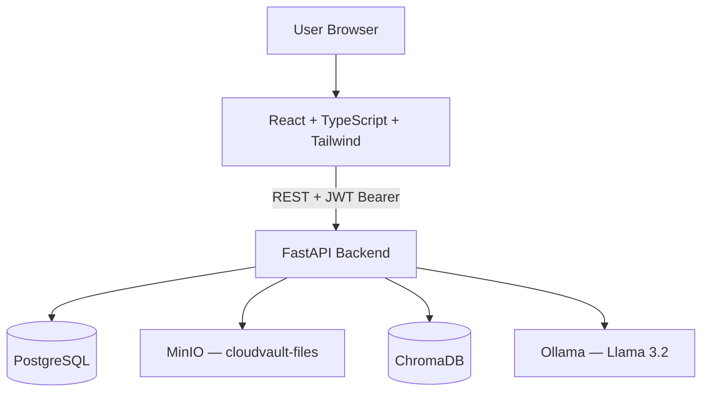

# DocNest

**Secure Cloud Document Intelligence Platform**

Upload PDFs to secure cloud storage, get AI-generated summaries and quality scores, and chat with your documents using a RAG pipeline powered by Llama 3.2.

## Architecture



## Quick Start

```bash
# 1. Configure environment
cp .env.example .env

# 2. Start all services
make start

# 3. Pull Ollama models (first time only)
make pull-models

# 4. Run database migrations
make migrate

# 5. Create admin user (interactive)
make admin

# First time complete command
make start && make pull-models && make migrate && make admin
```

## Access

| Service | URL |
|---------|-----|
| Frontend | http://localhost:5173 |
| API docs | http://localhost:8000/docs |
| MinIO console | http://localhost:9001 |

**Admin login:** created via `make admin` (interactive prompts)

## Features

- JWT authentication with bcrypt and email verification
- Role-based access control (Admin, User, Viewer)
- PDF upload/download with MinIO cloud storage
- Document versioning with backup history and restore
- RAG pipeline: PyMuPDF → Chunk → Embed → ChromaDB → Llama 3.2
- AI summarization, document scoring, and contextual Q&A chat
- Vault dashboard with stats, score rings, and inline chat
- Audit logging for security-sensitive actions

## Development

### Dev email verification

Without SMTP configured, verification links are logged to the backend console. Set `DEV_SKIP_VERIFY=true` in `.env` to skip email verification during development.

### Local frontend (without Docker)

```bash
cd frontend && npm install && npm run dev
```

### Local backend (without Docker)

```bash
cd backend && pip install -r requirements.txt && uvicorn main:app --reload
```

## Test Walkthrough

1. Start services and pull Ollama models (see Quick Start)
2. Log in as admin at http://localhost:5173/login
3. Upload a PDF from the Vault dashboard
4. Wait for processing (summary + score appear on document detail)
5. Chat with the document using inline chat or the Chat hub
6. View audit logs on the Security page (admin only)
7. Check version history and restore on document detail

## Project Structure

```
DocNest/
├── docker-compose.yml
├── backend/          FastAPI + SQLAlchemy + RAG services
├── frontend/         React + TypeScript + Tailwind
└── TECHNICAL_SPEC.md Full specification
```
